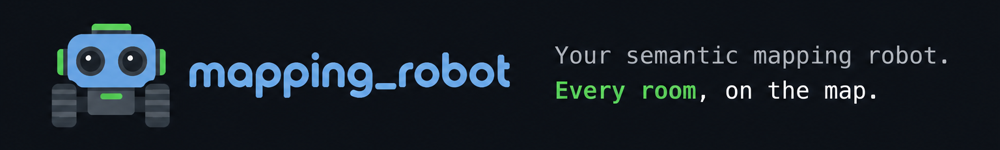
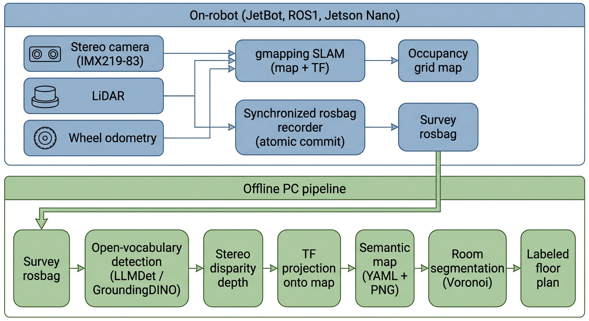
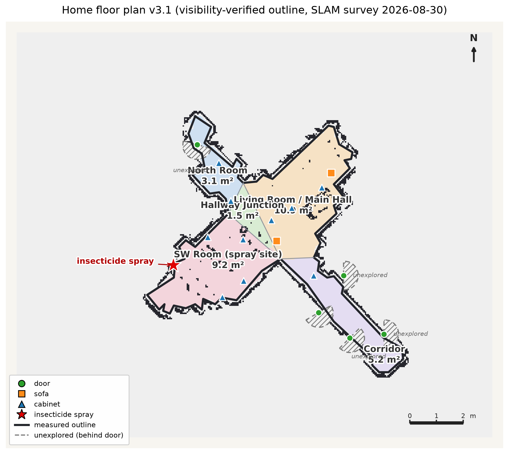
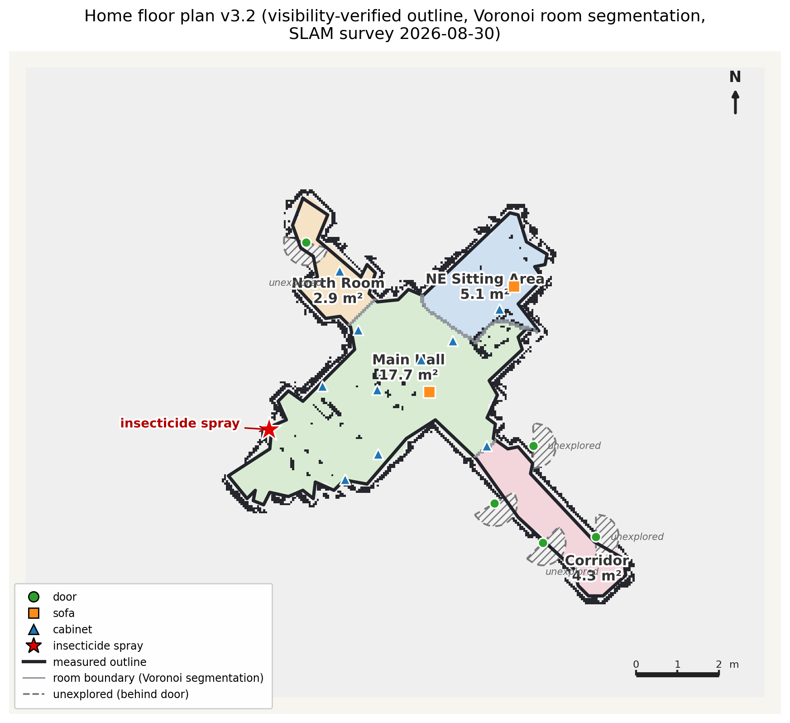

# SCOUT — Semantic Cartography Over Unknown Terrain

> **Author & maintainer:** [daliu858](https://github.com/daliu858) — design, architecture, field testing, review.
> Development used AI pair programming; those commits are co-authored with Claude, as the contributor list reflects.



An indoor **semantic mapping robot** built on a Waveshare JetBot Pro (Jetson Nano, ROS1 Melodic).
The workflow combines supervised tele-operated surveys with offline processing:

1. a 2D occupancy-grid map (gmapping), recorded together with a synchronized
   stereo-camera / LiDAR / odometry / TF rosbag ("one-pass capture" within each
   survey run);
2. offline open-vocabulary object detection (LLMDet / GroundingDINO — no
   task-specific training) on the recorded stereo frames;
3. stereo disparity depth + SLAM TF projection, placing detected points of
   interest (doors, sofas, cabinets, vending machines, ...) onto the map;
4. room segmentation (two methods, see below) and an optional
   labeled floor-plan rendering pipeline (`floorplan/`).

The motivation: mainstream navigation apps do not work inside buildings because
providers cannot obtain effective, up-to-date indoor data. A small robot that any
student can run (with the building owner's approval) can build a
building-specific semantic map instead.

## Survey renderings

These renderings combine **two supervised tele-operated survey runs** of a real
apartment. "One-pass capture" describes synchronized recording within each run;
the renderings use both trajectories for the visibility check.

The same measured outline is segmented in two ways: v3.1 cuts chords between
concave corners; v3.2 uses Voronoi segmentation (Bormann et al., ICRA 2016,
Sec. III-C). Their different room boundaries are part of the result. The outline
is the measured occupancy-map boundary with light `approxPolyDP` smoothing;
it has not been straightened into right-angled walls.

The red star marks an open-vocabulary `insecticide spray` query hit, demonstrating
LLMDet localization of a long-tail class without training on this home. Doors,
sofas and cabinets are common classes in the same query set. The
`HALL_V1_CLASSES` prompts map `cabinet door` to cabinet, use `daybed` to catch
the covered sofa, and deliberately omit `bed`.

<table>
  <tr>
    <td align="center" width="50%">
      <br>
      <sub><b>Approach A</b>: zones cut along chords between concave corners of the outline (<code>floorplan/make_floorplan_v31.py</code>)</sub>
    </td>
    <td align="center" width="50%">
      <br>
      <sub><b>Approach B</b>: Voronoi graph-based room segmentation, after Bormann et al., ICRA 2016, Sec. III-C (<code>floorplan/make_floorplan_v32.py</code>)</sub>
    </td>
  </tr>
</table>

The corresponding rosbags and occupancy maps are not distributed. The two
published images are retained unchanged; the synthetic example below exercises
the rendering code with public, fictional data.

## Repository layout

| Path | What it is |
|---|---|
| `overlay/jetbot_pro/` | **Original files written for this project** that sit on top of the upstream [waveshare/jetbot_pro](https://github.com/waveshare/jetbot_pro) package: semantic mapper, stereo calibration pipeline, capture/replay contracts, safety node, launch files, unit tests |
| `overlay/gscam/` | Original addition to [ros-drivers/gscam](https://github.com/ros-drivers/gscam): a raw-image side-channel copy node used by the capture pipeline (+ test) |
| `patches/` | `git diff` patches with the local modifications made to the two upstream packages (parameter tuning, EKF odometry fixes, moving hard-coded vendor API keys into environment variables, robustness fixes in `jetbot.cpp` / `gscam.cpp`) |
| `tools/` | Offline PC-side pipeline: bag analysis, stereo timestamp checks, detection, semantic-layer merging, POI de-duplication, room segmentation (incl. a Voronoi implementation written with reference to Bormann et al.'s room-segmentation survey, ICRA 2016), map-identity manifests, glass keep-out map builder |
| `tests/` | PC-side pytest suites for the offline pipeline (artifact contracts, map identity, rosbag index compatibility, room-segmentation boundaries, detection post-processing) |
| `floorplan/` | Occupancy grid → labeled architectural floor plan. Geometry is fully deterministic; an LLM is optionally used **only** to propose room names and cannot alter any coordinate |
| `docs/` | Technical run-books (in Chinese): end-to-end demo guide, IMX219-83 stereo migration notes and calibration guide |

## Why patches instead of a full source tree

The upstream `jetbot_pro` package does not declare an open-source license, so its
code is not redistributed here. This repository contains only (a) files written
for this project and (b) diffs against the pinned upstream commits. Run
`./setup_workspace.sh` to assemble a complete `catkin_ws/src`:

```bash
./setup_workspace.sh ~/catkin_ws/src
```

It clones the two upstream repos at the pinned commits, applies the patches, and
copies the overlay files on top.

Pinned upstream commits:

- `waveshare/jetbot_pro` @ `b76d483fbd5ceb41a66be4945ed2fc712b5d36a4`
- `ros-drivers/gscam` @ `1b0b8e51b91522edadd8399d4ad920f8afbc487d` (BSD)

## What is intentionally *not* in this repository

- Recorded rosbags and the raw occupancy maps (they were surveyed in a private
  home; both privacy-sensitive and far too large for git). The two rendered
  floor plans above are the only surveyed artifacts published, by choice.
- Model weights (see `tools/requirements-offline.txt` and the detection scripts
  for how to fetch them).
- API credentials of any kind. All external services are read from environment
  variables; nothing in this tree contains a key.

## Testing

```bash
python -m pip install -r requirements-test.txt
export JETBOT_TEST_SRC="$PWD/.test-workspace/src"
bash setup_workspace.sh "$JETBOT_TEST_SRC"
python -m pytest tests overlay/jetbot_pro/tests -q
```

Run these commands in Bash (Git Bash on Windows). The setup step downloads the
pinned upstream sources into a local test workspace and applies this repository's
patches and overlays; it does not build ROS or redistribute upstream code. CI
uses a fresh temporary workspace. Without this step, only tests that inspect
unredistributed upstream files explicitly skip; the four core segmentation,
artifact-contract, map-identity and stereo-geometry suites still run.

The test environment includes SciPy, scikit-image and Matplotlib because the
existing segmentation algorithms and renderer use them. It does not install
model, GPU, ROS or rosbag dependencies; tests requiring ROS or rosbags explicitly
skip when those optional environments are absent.

Render the fully synthetic three-room map and its four POI classes:

```bash
python floorplan/make_floorplan_v32.py \
  --map floorplan/fixtures/synthetic_apartment.yaml \
  --pois floorplan/fixtures/synthetic_pois.yaml \
  --no-visibility \
  --out floorplan/out_demo
```

Use `make_floorplan_v31.py` with the same arguments for the chord-based renderer.
Both scripts require `--map` and `--pois`; `--out` defaults to
`floorplan/out_demo/`. Visibility checks require explicit `--bag PATH` arguments
(repeat for multiple survey bags). With `--no-visibility`, no bag is opened.

## Development notes

Built and iterated over several months as a personal project. AI coding
assistants were used during development (pair-programming and code review);
every change that reached the robot went through the preflight/contract checks
and the test suites above, and field failures were diagnosed and
fixed by hand. The docs in `docs/` are the run-books actually used during
surveys.

## License

Original code is released under the [MIT License](LICENSE).
Third-party attribution and licensing details are in [THIRD_PARTY.md](THIRD_PARTY.md).

## What was sanitized before publishing (read this before filing a bug)

This repository was extracted from a private working tree. Before you conclude
that something is broken, check whether it is one of these deliberate removals:

1. **No private recorded data ships with the repo.** Real survey rosbags and
   occupancy maps are not distributed. Use your own survey data or the explicitly
   synthetic map and POIs in `floorplan/fixtures/`; neither fixture contains
   measurements from a home.
2. **`floorplan/doors_sample.yaml` contains fictional coordinates.** It is a
   format example only; real door positions were replaced for privacy.
3. **Upstream sources are not vendored.** `overlay/` + `patches/` only become a
   buildable catkin workspace after running `./setup_workspace.sh` (it clones
   the pinned upstream commits and assembles everything). Building this repo
   directly with `catkin_make` will not work.
4. **The patch deliberately skips the vendor voice-demo files**
   (`scripts/aiui.py`, `scripts/iat.py`, `scripts/tts_cn.py`,
   `launch/tts.launch`, `scripts/multipoint_nav.py`): upstream hard-codes
   vendor API credentials there, and voice control is unrelated to semantic
   mapping. After `setup_workspace.sh`, those files remain exactly as upstream
   ships them.
5. **No credentials of any kind are included.** External services (e.g. the
   optional LLM room-naming step in `floorplan/`) read keys from environment
   variables / a local `.env` that you supply yourself. Detection model
   weights are also fetched separately (see `tools/requirements-offline.txt`).

## Contact

If anything doesn't work, or if you have **any** concern about this repository
(licensing, privacy, attribution — anything at all), please contact me right
away: **mapping_robot@proton.me**. I will respond and fix it.
